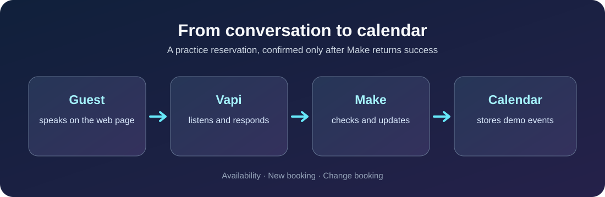

# Potala AI Voice Reservations

**A German-first, English-capable voice reservation demo for Potala Restaurant in Olten.**

[Try the web demo](https://potala-voice-demo-2026.ochrescout3.chatgpt.site) · [How it works](docs/project-overview.md) · [Setup](docs/setup.md) · [Test record](docs/test-plan.md)

> [!IMPORTANT]
> This project uses a **demo calendar**. Successful tool calls create or change practice events, not confirmed reservations at the real restaurant. The web demo requires a Vapi public key and assistant ID supplied by the owner; starting a call uses Vapi credit.

## What it can do

| Guest request | Result |
| --- | --- |
| “Is Tuesday at 18:00 available?” | Vapi asks Make to check restaurant rules and the demo calendar. |
| “Please book it.” | After the guest confirms, Make rechecks and creates a 90-minute event. Vapi reads the returned booking reference. |
| “I need to change my booking.” | Make matches the booking reference and saved phone, checks the new slot, and updates the same event. |

**Current scope:** one indoor table for 1–4 guests; 15 demo tables; Monday closed; Zurich time. [Exact permitted start times](docs/workflow.md).

## Quick start

1. Open the [web demo](https://potala-voice-demo-2026.ochrescout3.chatgpt.site).
2. In its setup panel, enter the **restricted public** Vapi key and assistant ID for the Potala assistant. Never enter a private API key.
3. Allow microphone access and select **Start Conversation**. Try a future permitted date with fictional details.

To rebuild or switch Vapi organizations, use the [setup guide](docs/setup.md). The source for the page is in [`web/`](web/); sanitized Make reference exports are in [`make/`](make/). They require reconnection and verification after import.

## Documentation

- [Project overview](docs/project-overview.md) — a short explanation for someone new to Vapi and Make.
- [Detailed workflow](docs/workflow.md) — booking rules, change flow, and limitations.
- [Setup and new Vapi account](docs/setup.md) — the three tools, web key, and reconnection steps.
- [Confirmations](docs/confirmations.md) — how the booking reference works and proposed email/SMS delivery.
- [Vapi system prompt](docs/vapi-system-prompt.md) — latest local reference copy; compare against the published assistant.
- [Test record](docs/test-plan.md) · [Checklist](docs/checklist.md) — what has been checked and what remains.

## Next improvements

Written confirmation, cancellation, an inbound phone number, holiday hours, staff escalation, and stronger verification. Before real restaurant use, prevent simultaneous calls from overbooking the last table and agree on privacy and retention rules. **Automatic email/SMS is not active yet.**

Do not commit Make webhook URLs, Google Calendar identifiers, private Vapi keys, real guest data, or unredacted scenario exports.
