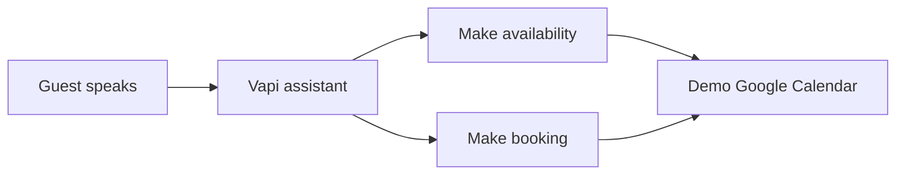

# Potala AI reservation demo

A German-first voice reservation demonstration for Potala Restaurant in Olten. The assistant speaks through Vapi, calls two Make scenarios, and reads/writes a separate Google Calendar used only for practice reservations.

**Status (23 October 2026):** the Vapi assistant and both Make scenarios have been tested; the public demo page is published. A visitor needs a restricted Vapi public key and assistant ID from the host to start a call. This is a demo, not the live restaurant booking service.

The optional phone-number mapping is now verified end to end: the published Vapi booking tool v3 passed a fictional number through Make into a new demo Calendar event during a web voice call. The agent currently creates bookings but has no lookup, change, or cancellation tool for existing events.

## Architecture

Vapi handles speech, dialogue, and tool calls. Make applies the reservation rules. Google Calendar stores demo events. The browser page starts a web call to the existing Vapi assistant; it does not call Make directly.

## Files

- [`docs/workflow.md`](docs/workflow.md): exact business flow, operating rules, and limitations.
- [`docs/setup.md`](docs/setup.md): reconnecting Vapi, Make, Google Calendar, and the public demo page.
- [`docs/test-plan.md`](docs/test-plan.md): verified tests and the minimal final test.
- [`docs/presentation.md`](docs/presentation.md): a short presentation script.
- [`docs/vapi-prompt-reference.md`](docs/vapi-prompt-reference.md): a prompt reference reconstructed from the working design. Copy the actual published prompt from Vapi before treating this as an exact backup.
- [`docs/vapi-system-prompt.md`](docs/vapi-system-prompt.md): revised paste-ready system prompt based on the prompt supplied by the owner on 23 October 2026.
- [`docs/change-booking-plan.md`](docs/change-booking-plan.md): requirements and a low-credit plan for changing existing reservations later.
- [`make/`](make/): sanitized reference exports of the two scenarios. Reconnect webhooks, Google connections, and calendar after importing.
- [`web/`](web/): source for the public Start Conversation page.

## Privacy and deployment

Do not commit Make webhook URLs, Google Calendar IDs, private Vapi keys, customer data, or a downloaded unredacted Make blueprint. The `web/` page asks for a **public** Vapi key and assistant ID, saves them only in that browser, and starts a call only after a click. Restrict that public key to the page origin and the Potala assistant in Vapi.

The public presentation page is at <https://potala-voice-demo-2026.ochrescout3.chatgpt.site>. It contains no embedded Vapi key. Give a restricted public key and assistant ID only to intended testers; anyone with those values can initiate a call from the allowed page origin and consume Vapi credit.
